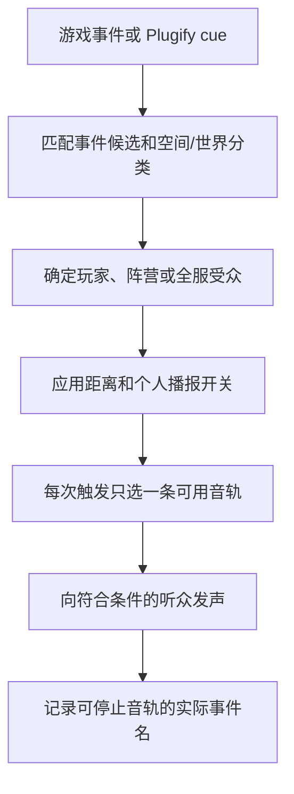

# Architecture and Design

`imomoe_sounds` 通过 S2SDK 接入游戏事件、聊天命令和资源清单；只在游戏线程调用引擎。外部 ABI、事件、指令和生命周期入口均捕获 Rust panic。

---

## 播放请求如何变成一次发声

`round_prestart` 清理上一回合可中断播报并重置第一滴血；正式局连杀按生命计数，不按回合或阵营重置。热身击杀使用独立连杀状态，不会带入正式局，热身仍可正常播报。阵亡与断线移除对应槽位计数。一次 tick 内同一凶手的多次敌对击杀先合并候选，按第一滴血、最高连杀、终结、武器、爆头、普通击杀的优先级只选一条；后续击杀仍更新连杀。误杀可播报，但不占用敌对击杀同 tick 配额；已埋 C4 造成的无归属死亡不会误播自杀。

选择结果在同一次触发中共享；个人设置只决定是否接收，不改变选中的曲目。全服受众包括真人观察者与 CSTV；T／CT 阵营的假客户端不参与。空间播报对存活玩家按本人位置限距，对阵亡玩家和观察者仅在第一人称观战时按当前目标位置限距；漫游、追踪视角和无效目标不接收。观察服务 Schema 偏移每张地图验证并缓存。世界播报和空间发声使用不同的实体来源，战术 cue 无法通过世界播报接口触发。

`player_connect_full` 跳过 BOT 并按 `join_server` 的 actor/all 受众及个人偏好播报。`round_end` 按 winner 选择 CT、T；无胜方且 reason 为 Draw（10）时选平局键，GameStart 等其他原因使用公共 `round_end`。结果键缺失时也使用公共键，显式空列表保持静音。裁剪的 S2SDK 若缺少 `GetEventInt`，启动时记录提示并沿用公共键；其他播报仍可用。

Sounds 将普通 `round_start` 播报延到下一帧；配对的 FunRounds 通过 `BroadcastRoundStartCue` 提交模式 BGM。同 tick 成功发出模式 BGM 时跳过默认播报；曲目不可用或没有成功发出时保留默认播报。通用 `BroadcastCue` 不参与这项裁决。

## 资源和状态生命周期

| 状态 | 管理方式 |
| --- | --- |
| Workshop 可用资产 | 每次构建地图 Manifest，确认物品在 `s2_extra_addons`、检查编译后的事件表与资源，再调用 `Precache`。缺少文件时只跳过关联音轨。当前 Sounds 使用 `ReadFileVPK` 检查编译文件；配对 S2SDK 的实现会把完整文件读入 buffer 并返回字符串。SDK 也导出绝对路径枚举，但没有证据证明它能检查 VPK 内部条目，所以仍逐图检查以匹配 Workshop 挂载状态，不缓存上张图结果。 |
| 顺序游标 | 每个 cue 一个游标，地图结束清空。 |
| 播报个人偏好 | 以 SteamID64 为键，记录相对服务端默认值的差异。`!sound` 切换时在同目录临时写入并原子替换；失败时告知玩家只对本次会话生效。读到损坏文件时保留原件。 |
| 空间音轨 | 以完整实体句柄与 cue 为键，只跟踪已请求播放的实际事件；重播、明确停止或卸载时停止，删除实体或换图时丢弃记录。 |
| 可中断世界音轨 | 记录实际事件名，`round_prestart` 或卸载时停止。若两个世界 cue 共用事件名，Source 2 会一起停止；给需要独立停止的 BGM 分配独立事件名。 |

FunRounds 拥有模式配置、实体身份、呼吸节拍和自爆倒计时；Sounds 拥有选曲、声源、距离与停止。具体配对见 [联动交付](FUNROUNDS_INTEGRATION.md)。
