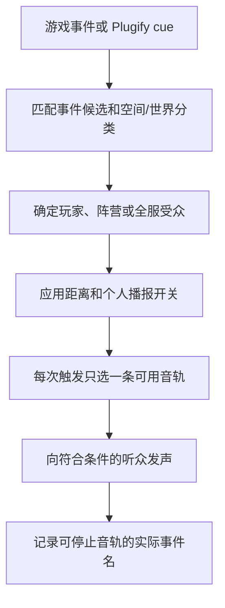
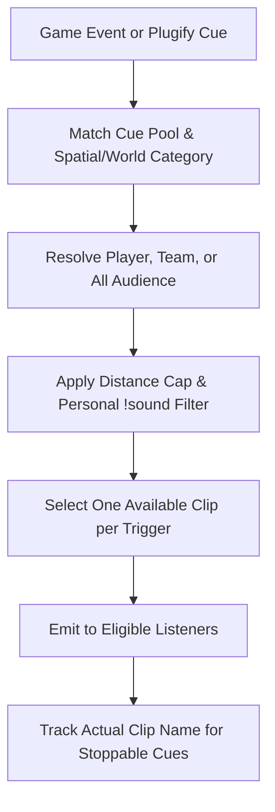

# Architecture and Design / 架构与设计

[简体中文](#简体中文) | [English](#english)

---

## 简体中文

`imomoe_sounds` 通过 S2SDK 接入游戏事件、聊天命令和资源清单；只在游戏线程调用引擎。外部 ABI、事件、指令和生命周期入口均捕获 Rust panic。

---

### 播放请求如何变成一次发声

`round_prestart` 清理上一回合可中断播报并重置第一滴血、连杀时间窗（`combo`）、回合内连续爆头（`headshot_streak`）及同 Tick 缓存队列；正式局连杀（`streak`）按生命计数，不按回合或阵营重置。热身击杀使用独立战斗状态，不会带入正式局，热身仍可正常播报。阵亡与断线移除对应槽位计数；已埋 C4 造成的无归属死亡不会误播自杀。

同一击杀者或误杀者在同 Tick 产生的多次死亡事件先进入批次队列并在下一帧 `OnGameFrame` 结算，按 `first_blood` → `combo.N`（最大 N 优先）→ `streak.N`（最大 N 优先）→ `streak_shutdown` → `weapons.<name>` → `headshot_streak.N`（最大 N 优先）→ `headshot` → `kill` → `teamkill` 排序候选。ConVar `imomoe_sounds_exclusive`（默认 `1`）控制互斥策略：`1` 时每批次仅播优先级最高的一条可用候选；`0` 时按维度（`FirstBlood`、`Combo`、`Streak`、`StreakShutdown`、`Weapon(name)`、`Headshot`、`Kill`、`Teamkill`）各自至多播一条。无论是否互斥，全部计数照常推进。

选择结果在同一次触发中共享；个人设置只决定是否接收，不改变选中的曲目。全服受众包括真人观察者与 CSTV；T／CT 阵营的假客户端不参与。空间播报对存活玩家按本人位置限距，对阵亡玩家和观察者仅在第一人称观战时按当前目标位置限距；漫游、追踪视角和无效目标不接收。观察服务 Schema 偏移每张地图验证并缓存。世界播报和空间发声使用不同的实体来源，战术 cue 无法通过世界播报接口触发。

`player_connect_full` 跳过 BOT 并按 `join_server` 的 actor/all 受众及个人偏好播报。`round_end` 按 winner 选择 CT、T；无胜方且 reason 为 Draw（10）时选平局键，GameStart 等其他原因使用公共 `round_end`。结果键缺失时也使用公共键，显式空列表保持静音。裁剪的 S2SDK 若缺少 `GetEventInt`，启动时记录提示并沿用公共键；其他播报仍可用。

Sounds 将普通 `round_start` 播报延到下一帧；配对的 FunRounds 通过 `BroadcastRoundStartCue` 提交模式 BGM。同 tick 成功发出模式 BGM 时跳过默认播报；曲目不可用或没有成功发出时保留默认播报。通用 `BroadcastCue` 不参与这项裁决。

---

### 资源和状态生命周期

| 状态 | 管理方式 |
| --- | --- |
| Workshop 可用资产 | 每次构建地图 Manifest，确认物品在 `s2_extra_addons`、检查编译后的事件表与资源，再调用 `Precache`。缺少文件时只跳过关联音轨。当前 Sounds 使用 `ReadFileVPK` 检查编译文件；配对 S2SDK 的实现会把完整文件读入 buffer 并返回字符串。SDK 也导出绝对路径枚举，但没有证据证明它能检查 VPK 内部条目，所以仍逐图检查以匹配 Workshop 挂载状态，不缓存上张图结果。 |
| 顺序游标 | `sequential` 按 Cue 维护全局游标（换图清空）；`actor_sequential` 按玩家槽位或实体句柄维护独立游标。阵亡所在 Tick 的播报结算后，只清除阵亡玩家的游标；断线、实体删除或换图也会清理对应游标。 |
| 播报个人偏好 | 以 SteamID64 为键，记录相对服务端默认值的差异。`!sound` 切换时在同目录临时写入并原子替换；失败时告知玩家只对本次会话生效。读到损坏文件时保留原件。 |
| 空间音轨 | 以完整实体句柄与 cue 为键，只跟踪已请求播放的实际事件；重播、明确停止或卸载时停止，删除实体或换图时丢弃记录。 |
| 可中断世界音轨 | 记录实际事件名，`round_prestart` 或卸载时停止。若两个世界 cue 共用事件名，Source 2 会一起停止；给需要独立停止的 BGM 分配独立事件名。 |

FunRounds 拥有模式配置、实体身份、呼吸节拍和自爆倒计时；Sounds 拥有选曲、声源、距离与停止。具体配对见 [联动交付](FUNROUNDS_INTEGRATION.md)。

---

## English

`imomoe_sounds` integrates with game events, chat commands, and resource manifests through S2SDK on the game thread only. All external ABI, event, command, and lifecycle entry points catch Rust panics.

---

### Request Flow

- `round_prestart` stops interruptible tracks from the prior round and resets `first_blood`, `combo`, `headshot_streak`, and per-tick queues; live-match `streak` persists across rounds/side swaps until death or disconnect. Warmup uses isolated state.
- Multiple deaths from the same attacker in one tick queue and resolve on the next `OnGameFrame`, ordered by `first_blood` → `combo.N` → `streak.N` → `streak_shutdown` → `weapons.<name>` → `headshot_streak.N` → `headshot` → `kill` → `teamkill`. ConVar `imomoe_sounds_exclusive` (`1` default) emits only the top candidate; `0` emits up to one per dimension; all counters advance in both modes.
- Global broadcasts include human spectators and CSTV while excluding T/CT bots. Spatial cues filter alive players by self position and dead/spectating players only in first-person mode by spectated target position.
- `round_start` defers one frame so `BroadcastRoundStartCue` can suppress the default track if a mode BGM emits on that tick.

---

### Resource & State Lifecycle

| State | Management |
| --- | --- |
| Workshop Assets | Verified per map during `OnBuildGameSessionManifest` via `ReadFileVPK` against `s2_extra_addons` before `Precache`; missing files skip only affected clips. |
| Sequence Cursors | `sequential` tracks global map-scoped cursors; `actor_sequential` tracks per-slot or per-entity cursors. After resolving the death tick's announcements, clear only the victim's cursors. Disconnect, entity deletion, and map end also clear the corresponding cursors. |
| Personal Preferences | Keyed by SteamID64, storing only differences from `enabled_by_default`, written atomically via same-directory temp replacement. |
| Spatial Cues | Keyed by full entity handle and cue; stopped on replay, `StopCue`, or unload, and dropped on entity deletion or map change. |
| Interruptible World Cues | Tracks actual emitted event names and stops them on `round_prestart` or unload. |

See [FunRounds Integration](FUNROUNDS_INTEGRATION.md#english) for the integration contract.
